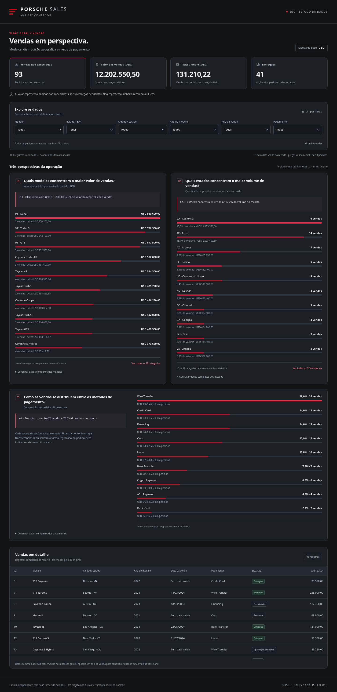
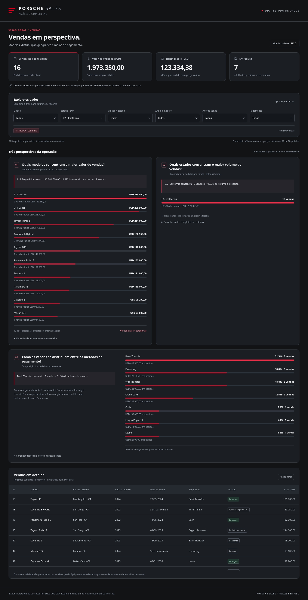

# Porsche Sales

Dashboard de vendas e pedidos desenvolvida para o desafio de Excel com IA da DIO. Usa os registros reais da planilha fornecida, com filtros simultâneos e regras explícitas para cancelamentos e datas inválidas. É um estudo educacional, sem vínculo oficial com a Porsche.

**Repositório para entrega:** [bernardo18377/DIO-Bernardo-EXCEL-IA-4](https://github.com/bernardo18377/DIO-Bernardo-EXCEL-IA-4).

**Abra [`index.html`](index.html) diretamente no navegador.** O arquivo contém estilos, scripts e os dados necessários: funciona offline, sem instalação, servidor, build, CDN ou login. Para compartilhar somente a dashboard, basta copiar esse HTML.

## O que a análise responde

| Pergunta | Por que analisar | Resultado no conjunto comercial completo |
| --- | --- | --- |
| Quais modelos concentram o maior valor de vendas? | Comparar a contribuição dos produtos, preservando suas versões. | **911 Dakar:** 3 vendas, **USD 810.600,00**. |
| Quais estados concentram o maior volume de vendas? | Identificar a concentração geográfica da amostra nos Estados Unidos. | **CA (Califórnia): 16 vendas**, 17,2% das 93. |
| Como as vendas se distribuem entre os métodos de pagamento? | Examinar a composição dos meios de pagamento sem presumir recebimento. | **Wire Transfer: 26 vendas**, 28,0% das 93, somando USD 3.979.450,00. |

Esses exemplos foram recalculados a partir da planilha. Na dashboard, conclusões, percentuais, indicadores, rankings e tabela acompanham os mesmos filtros. Os rankings mostram inicialmente as dez primeiras categorias e permitem expandir todas; as tabelas de apoio contêm o conjunto completo.

## Dados e regras

A fonte é a [planilha fornecida pela DIO](https://hermes.dio.me/files/assets/8683bed0-cc33-4e06-bca9-04db9c31f9e2.xlsx), também recebida como anexo neste trabalho. A aba utilizada foi `Sanitized`. A cópia original não é publicada: contém nomes de pessoas desnecessários à análise. O JSON tratado conserva somente ID, data, modelo, ano do modelo, preço, pagamento, cidade, estado e situação da entrega.

| Conferência da fonte | Resultado |
| --- | ---: |
| Registros importados / IDs únicos | 100 / 100 |
| Cancelados, preservados no JSON e excluídos da análise comercial | 7 |
| Vendas não canceladas | 93 |
| Valor dos pedidos não cancelados | USD 12.202.550,50 |
| Ticket médio dos pedidos com preço válido | USD 131.210,22 |
| Entregues (`Delivered`) | 41 |
| Datas inválidas: fonte / conjunto comercial | 24 / 23 |
| Preços inválidos ou ausentes | 0 |

- **Moeda:** USD, sem conversão para BRL. Valores calculados em centavos inteiros; formatação somente na apresentação.
- **Conjunto comercial:** exclui somente `Cancelled`; inclui pedidos com entregas pendentes. Valor de vendas é o valor registrado dos pedidos, sem afirmar dinheiro recebido, receita contábil, margem ou lucro.
- **Ticket médio:** soma dos preços válidos dividida pela quantidade de registros com preço válido no recorte. Não é média de médias.
- **Datas:** `INVALID` e datas impossíveis tornam-se `null`. Esses registros permanecem nas métricas gerais. O filtro de ano da venda oferece `Sem data válida`; selecionar um ano específico exclui datas inválidas.
- **Dois tipos de ano:** ano do modelo vem de `ModelYearSanitized`; ano da venda vem exclusivamente da data válida. Datas reais entre **14/03/2024 e 01/10/2027** foram mantidas, inclusive as futuras da base didática.
- **Categorias:** versões de modelos e meios como `Wire Transfer`, `Bank Transfer` e `ACH Payment` continuam distintos. Filtros usam interseção lógica (AND) e não apagam escolhas automaticamente.
- **Ausência e zero:** preço ausente não é zero. O painel informa a cobertura monetária; sem preços válidos, valor e ticket ficam indisponíveis. Recorte vazio mostra zero vendas, zero valor e ticket indisponível.
- **Rankings:** ordenação decrescente pela medida principal e desempate alfabético consistente; empates na liderança são informados no texto. Percentuais usam o volume do recorte atual.

O dicionário completo, hash da entrada e critérios estão em [`docs/tratamento-dados.md`](docs/tratamento-dados.md).

## Reproduzir os dados e os testes

Visualizar o HTML não exige Python. Para reproduzir a extração e executar as verificações, use Python 3.12 ou compatível, as dependências abaixo e uma cópia local da planilha. Mantenha a fonte fora do Git; `.gitignore` também exclui arquivos Excel.

Na raiz do projeto:

```sh
python3 -m venv .venv
. .venv/bin/activate
python3 -m pip install -r requirements-dev.txt
export PORSCHE_SOURCE="/caminho/8683bed0-cc33-4e06-bca9-04db9c31f9e2.xlsx"
python3 scripts/preparar_dados.py "$PORSCHE_SOURCE" --html index.html
```

O script gera `data/vendas-sanitizadas.json` e substitui exclusivamente o bloco JSON incorporado no HTML. Não edita a fonte, não preenche totais com constantes e interrompe a importação se houver IDs repetidos, fórmulas sem resultados verificados ou estouro do limite inteiro seguro. Uma nova base passa pelas mesmas conversões e atualiza as opções dos filtros sem edição manual.

Testes de conversão e preparação:

```sh
python3 -m unittest discover -s tests -p 'test_preparar_dados.py' -v
```

Os testes de navegador usam Playwright e Chromium. Neste ambiente foi usado `/usr/bin/chromium`; em outro ambiente, instale um Chromium compatível ou use o navegador do Playwright:

```sh
python3 -m playwright install chromium
export CHROMIUM_PATH="$(python3 -c 'from playwright.sync_api import sync_playwright; p=sync_playwright().start(); print(p.chromium.executable_path); p.stop()')"
python3 -m unittest discover -s tests -p 'test_dashboard_browser.py' -v
```

Para rodar ambas as suítes com a fonte original disponível:

```sh
python3 -m unittest discover -s tests -v
```

Sem `PORSCHE_SOURCE`, a auditoria da fonte na suíte de preparação fica explicitamente ignorada e a suíte de navegador informa o requisito ausente. Isso não equivale a uma validação completa. Dependências de desenvolvimento não são usadas ao abrir a dashboard.

## Evidências e ferramentas

A implementação foi feita com **Codex**, com agentes auxiliares para preparação, interface e testes. A skill **cloud-environment-onboarding:setup** foi utilizada na preparação inicial do ambiente e para orientar o registro da configuração de rede. O projeto usa HTML semântico, CSS, JavaScript puro, Python/openpyxl para extração, `unittest` e Playwright com Chromium para testes reais. Não usa bibliotecas remotas de gráficos.

A especificação original está integralmente em [`docs/prompt.md`](docs/prompt.md). O registro dos comandos, resultados e limitações está em [`docs/validacao.md`](docs/validacao.md).

Foram aprovados **16 testes de preparação** e **8 testes de navegador**. Um teste de abertura direta por `file://` foi explicitamente ignorado porque a política gerenciada do Chromium bloqueia esse esquema. Os testes comportamentais carregaram o conteúdo do HTML com a rede desativada; um smoke test adicional confirmou o arquivo por HTTP local e testou o filtro depois de desativar a rede. A limitação de `file://` não foi contornada nem declarada como teste aprovado.

Capturas reais, feitas pelo script `python3 scripts/capturar_evidencias.py` com Chromium, após conferir os números:

**Visão geral:** 93 pedidos não cancelados, USD 12.202.550,50.



**Filtro aplicado:** estado CA (Califórnia), 16 pedidos, USD 1.973.350,00. A seleção está visível no controle e no indicador de filtros ativos.



A [captura móvel em 360 px](docs/img/mobile.png) mostra a adaptação do layout. A tabela mantém rolagem dentro do próprio contêiner.

## Publicação

O destino final escolhido pelo autor é o repositório existente **DIO-Bernardo-EXCEL-IA-4**. A entrega contém os arquivos descompactados na raiz: `index.html`, este README, `.gitignore`, `requirements-dev.txt` e as pastas `data/`, `docs/`, `scripts/` e `tests/`. O ZIP foi substituído por essa estrutura. A planilha original e os caches locais ficam fora do versionamento.

O envio de arquivos pelo Git funciona e foi verificado. **A ativação do site no GitHub Pages continua pendente:** a API do GitHub retorna HTTP 403 neste ambiente e ainda não há uma URL ativa da dashboard confirmada. Para ativar, abra **Settings → Pages → Deploy from a branch → main → /(root)** e salve. O `index.html` já está na posição correta, sem necessidade de build.

O diagnóstico e os passos de verificação estão em [`docs/publicacao.md`](docs/publicacao.md). Depois de confirmar o deploy, acrescente aqui a URL real informada pelo Pages.
